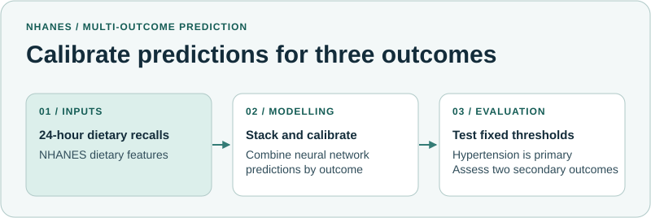

# Diet-Only Multi-Label Prediction Using a Calibrated Deep Learning Ensemble

This research notebook evaluates whether 24-hour dietary recalls alone can support calibrated risk stratification for three health outcomes.

| | |
| --- | --- |
| **Research question** | Can dietary recall alone support calibrated risk stratification, with hypertension as the primary outcome and type 2 diabetes and thyroid disorder as secondary outcomes? |
| **Data** | 24-hour dietary recalls from adult NHANES participants. |
| **Method** | Combine neural network predictions through per-outcome stacking and calibrate probabilities. Select thresholds on validation data and assess precision, recall and alerts per 1,000 on held-out data. Explore model explanations with SHAP. |

## My contribution

I prepared the data, implemented the modelling and calibration workflow, and evaluated how decision thresholds affected screening workload. My co-authors provided guidance on the study approach and reviewed the manuscript.

## What you can explore

The research notebook contains the modelling, calibration and threshold evaluation workflow. The diagram above summarises those steps.

## Notebook and data

[Open the research notebook](Final_Code.ipynb). Obtain the NHANES datasets separately from the CDC and review the notebook's data-loading cells for the expected inputs and local paths. [NHANES data source](https://www.cdc.gov/nchs/nhanes/about/index.html)

## Paper

*Diet-Only Multi-Label Prediction of Hypertension, Diabetes, and Thyroid Dysfunction Using a Calibrated Deep Learning Ensemble*

Shahin Ghanbari, Elaheh Homayounvala, and Sahar Al-Sudani

[Back to the research portfolio](https://github.com/Shahin-Ghanbari#featured-research)
